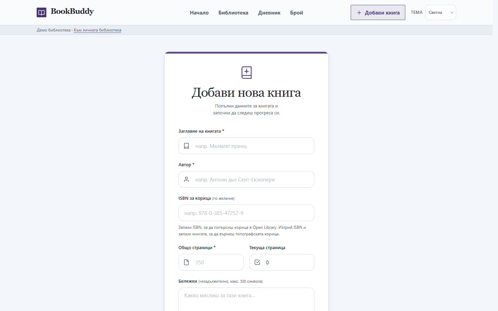

# BookBuddy · Читалня и лична библиотека

BookBuddy е уеб приложение за личен каталог на книги, читателски дневник със статистическа обсерватория и годишен редакционен брой („Читалня нощем“). Работи изцяло в браузъра с чист HTML, CSS и преносим JavaScript — без фреймуърк, без bundler, без регистрация и без външни runtime зависимости.

---

## Изгледи от приложението

### 1. Начална страница („В момента четеш“, 3D том, седмична цел, Предизвикателства и Топ 5)


### 2. Дневник и статистическа обсерватория (Годишна карта, Пръстен на серията, Хоризонт и Читателски записки)


### 3. Лична библиотека и форма за добавяне/редакция на книга


---

## Реализирана функционалност

- **Начало (`#home`)**:
  - Редакционна шапка с текущ месец и колофон („Читалня нощем“).
  - Кинетично серифно заглавие на текущо четената книга (`setKineticText` в `src/motion.js`) с пълна поддръжка на екранни четци и `prefers-reduced-motion: reduce`.
  - Триизмерен том (`.volume`) с типографска корица от мокъпа v4 (14 тематични геометрични орнамента в CSS), лента-отметка (`.bookmark`), чиято дължина следва процента прочетени страници (`--read`), и плавен 3D наклон при движение на показалеца.
  - Голяма типографска седмична цел (`#weeklyGoal`), текуща серия в дни (`#homeStreakValue`), секция „Предизвикателства“ („Седмичен спринт“ и „Серия 14 дни“) и класация „Топ 5“ най-четени книги по реално прочетени страници.
- **Моята библиотека (`#books`, `src/shelf.js`)**:
  - Дървен шкаф с три рафта според статуса на книгите: **„Чета сега“**, **„За четене“** и **„Прочетени“**.
  - Гръбчета с пропорционална дебелина спрямо броя страници (`46–76 px`), вертикално заглавие, автор, лента за напредък и печат „Прочетено“ при завършване.
  - Пълна клавиатурна навигация по рафтовете (`ArrowLeft`, `ArrowRight`, `ArrowUp`, `ArrowDown`, `Home`, `End` с roving `tabindex`).
  - Разгъване на книгата като отворена двустранна кола (`<dialog id="shelfPreview">`) с корица, бележки и последни сесии, както и подробен диалог „За книгата“ (`<dialog id="detailsModal">`) с бързо обновяване на текуща страница.
  - Търсене по заглавие/автор (с debounce `250 ms`), филтриране по статус и сортиране („Най-нови“, „По напредък“, „Заглавие А-Я“).
  - [Търси и избирай корица във формата за книга](readme-ai-project/docs/COVERS.md) чрез Google Books и Open Library.
- **Дневник и статистическа обсерватория (`#journal`, `src/stats.js`, `src/main.js`)**:
  - **I · Годишна карта на четенето (`#journalYearMap`)**: ръчно генерирана SVG карта по дни за цялата година (52–53 седмици × 7 дни) на тъмна сцена („Календарно съзвездие“) с 5 нива на интензитет, разграничени едновременно по размер, форма (точка, квадрат, вътрешно ядро, ромб) и контраст, плюс скрита таблица по месеци за екранни четци.
  - **II · Пръстен на серията (`#journalGoalRing`)**: двоен концентричен SVG пръстен (външна дъга за седмичната цел, вътрешна дъга за дневния пулс спрямо `седмична цел / 7`) с текущата серия (`#streakValue`) в центъра и таблица с показатели (седмична цел, дневен пулс, най-дълга серия).
  - **III · Месечен ритъм и пулс на сесиите (`#journalMonthlyChart`)**: комбинирана SVG графика с 12-месечен профил на прочетените страници и долен ред с вертикални импулси за последните 24 сесии, придружена от акценти за **най-силен месец**, **средно страници на сесия** и **средно страници на активен ден**.
  - **Литературен профил — Най-четени автори (`#journalAuthorsChart`)**: хоризонтална SVG класация на водещите до 6 автори по страници от сесии с ромбовидни и кръгли маркери.
  - **IV · Читателски записки (`#activityFeed`)**: редакционна хроника на сесиите с дата в полето, курсивна бележка с вертикална линия, контекст за книгата и действия „Редактирай“ / „Изтрий“. При празен дневник се показва илюстрирана сцена с пряк бутон за първа сесия.
- **Годишен брой (`#issue`, `src/issue.js`)**:
  - Избор на година, обобщени фигури за страници от сесии (форматирани по `bg-BG` с интервал за хиляди, напр. `4 493`), завършени книги, най-дълга серия, най-четен автор, най-силен месец и хронологичен указател на потвърдено завършените книги.
- **Форма за книга (`form.html`, `src/form.js`, `src/utils/validate.js`)**:
  - Добавяне и редактиране на книга (`form.html?id=<bookId>`) с валидация на заглавие, автор, общо страници, текуща страница, ISBN-10/ISBN-13 и бележка до 300 символа с брояч в реално време.
- **Демо режим (`?demo=1`) и офлайн кеш (`sw.js`)**:
  - Отварянето на `index.html?demo=1` или `form.html?demo=1` пренасочва всички операции през `sessionStorage` (`src/utils/appStorage.js`), без да променя личната библиотека в `localStorage`.
  - Service Worker (`readme-ai-project/sw.js`) кешира статичните ресурси (`bookbuddy-v2`) за офлайн достъп.

---

## Технологичен стек и архитектура

- **Езици и среда**: Чист HTML5, CSS3 (custom properties, CSS Grid, container queries, 3D transforms, native `<dialog>` и Popover API `popover="manual"`) и Vanilla JavaScript (ES6+), зареждан чрез класически `<script>` тагове.
- **Съхранение на данни (`src/utils/appStorage.js`)**:
  - Лична библиотека: `localStorage`
  - Демо библиотека (`?demo=1`): `sessionStorage`
  - Ключове:
    - `bookbuddy_books` — масив от книги (`BookRepo`)
    - `bookbuddy_reading_logs` — масив от читателски сесии (`LogRepo`)
    - `bookbuddy_settings` — настройки за седмична цел и минимум страници за ден от серията (`SettingsRepo`)
    - `bookbuddy_challenges` — състояние на читателските предизвикателства (`ChallengeRepo`)
    - `bookbuddy_theme` — избрана тема (`light`, `dark`, `system`)
    - `bookbuddy_demo_initialized` — флаг за заредени примерни данни в демо сесията

---

## Структура на проекта

```text
BookBuddy/
├── CLAUDE.md                        # Архитектурни и визуални правила за разработка
├── README.md                        # Основна документация на проекта
└── readme-ai-project/               # Корен на уеб приложението (сервира се от статичен сървър)
    ├── index.html                   # Главен екран: Начало, Библиотека, Дневник, Брой и диалози
    ├── form.html                    # Екран за добавяне и редактиране на книга
    ├── favicon.svg                  # Векторна икона на приложението
    ├── sw.js                        # Service Worker за офлайн кеш (bookbuddy-v2)
    ├── styles/
    │   └── style.css                # Дизайн токени, теми, компоненти, 3D книга, рафт и графики
    ├── src/
    │   ├── main.js                  # Контролер на началния екран, дневника, диалозите и демо данните
    │   ├── form.js                  # Контролер на формата за добавяне/редакция на книга
    │   ├── shelf.js                 # Интерактивен рафт, клавиатурна навигация и преглед на книга
    │   ├── stats.js                 # Чисти функции за агрегации и статистика (UMD + ES module)
    │   ├── issue.js                 # Годишен редакционен брой (#issue)
    │   ├── motion.js                # Кинетични заглавия, count-up числа и печат „Прочетено“
    │   ├── services/
    │   │   ├── bookRepo.js          # CRUD операции за книги (bookbuddy_books)
    │   │   ├── logRepo.js           # CRUD операции за читателски сесии (bookbuddy_reading_logs)
    │   │   ├── settingsRepo.js      # Настройки за цели и серия (bookbuddy_settings)
    │   │   └── challengeRepo.js     # Предизвикателства (bookbuddy_challenges)
    │   └── utils/
    │       ├── appStorage.js        # Изолация между localStorage и sessionStorage (?demo=1) + SW регистрация
    │       ├── theme.js             # Управление на светла/тъмна/системна тема (bookbuddy_theme)
    │       └── validate.js          # Валидация на форма и ISBN-10/ISBN-13
    ├── tests/
    │   └── stats.test.mjs           # Unit тестове за статистическия модул (Node.js)
    └── docs/
        ├── AI_CONTEXT.md            # Технически контекст и потоци от данни
        ├── UI_STYLE.md              # Дизайн система, цветови и анимационни токени
        ├── UI_REFERENCE.md          # Справочник на екраните, DOM структурите и компонентите
        ├── mock/
        │   └── bookbuddy_mockup_v4.html # Еталонен визуален мокъп v4 („Читалня нощем“)
        └── shots/                   # Екранни снимки преди/след по етапи
```

---

## Стартиране локално

Приложението не изисква `npm install` или стъпка за компилация. Сервирай папката `readme-ai-project/` с произволен статичен HTTP сървър на порт `8094`:

```bash
# Вариант 1: с npx serve
npx serve readme-ai-project -l 8094

# Вариант 2: с Python
python -m http.server 8094 --directory readme-ai-project
```

След стартиране отвори в браузър:
- Лична библиотека: `http://127.0.0.1:8094/index.html`
- Демо библиотека с готови данни: `http://127.0.0.1:8094/index.html?demo=1`
- Форма за добавяне на книга: `http://127.0.0.1:8094/form.html`

---

## Пускане на тестовете

Чистите функции за статистиката и дневника (`readme-ai-project/src/stats.js`) са покрити с автоматизирани unit тестове за Node.js:

```bash
node readme-ai-project/tests/stats.test.mjs
```

Очакван изход: `ALL 8 TESTS PASSED.`

---

## Планирано (не е част от текущата версия)

Следните идеи от ранните концепции **не са имплементирани** в текущия код и са оставени за бъдещи етапи:
- Потребителски акаунти, вход/регистрация и облачна синхронизация (в момента всички данни се пазят локално в браузъра).
- Автоматично търсене на корици през Google Books API (текущата версия използва типографски корици и незадължителен ISBN преглед през Open Library).
- Вграден таймер за отчитане на време за четене в реално време (сесиите се записват по дата и брой прочетени страници).
- Експорт и импорт на библиотеката в JSON/CSV файл.
